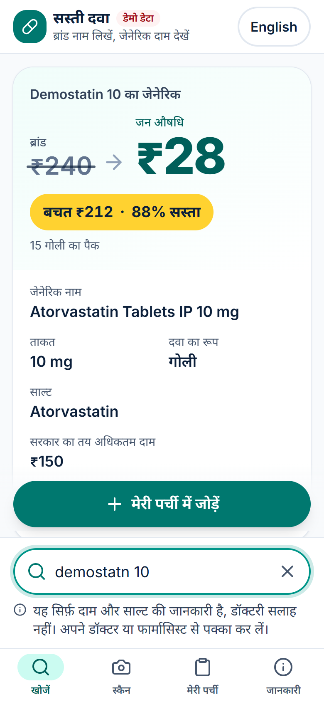
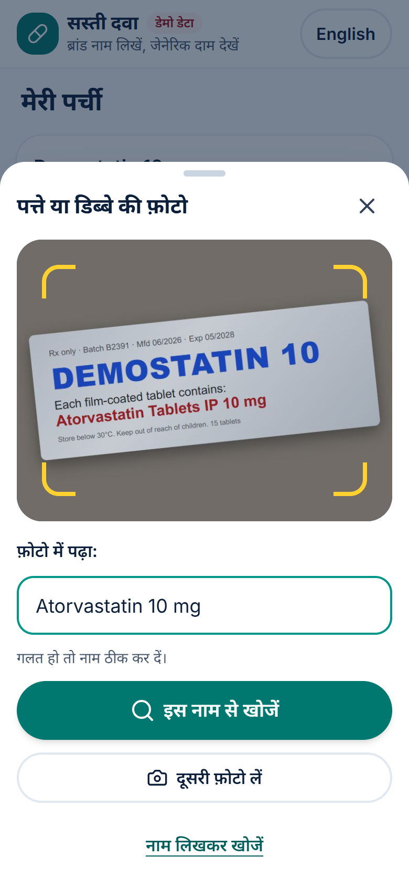
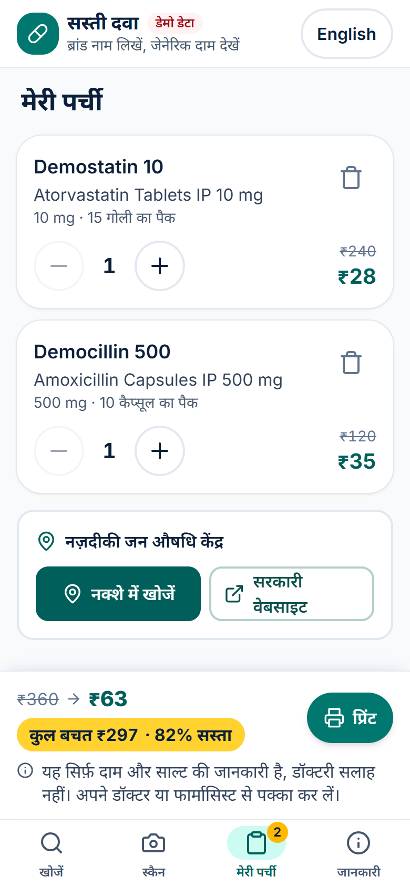
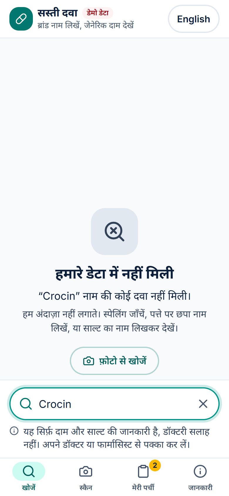
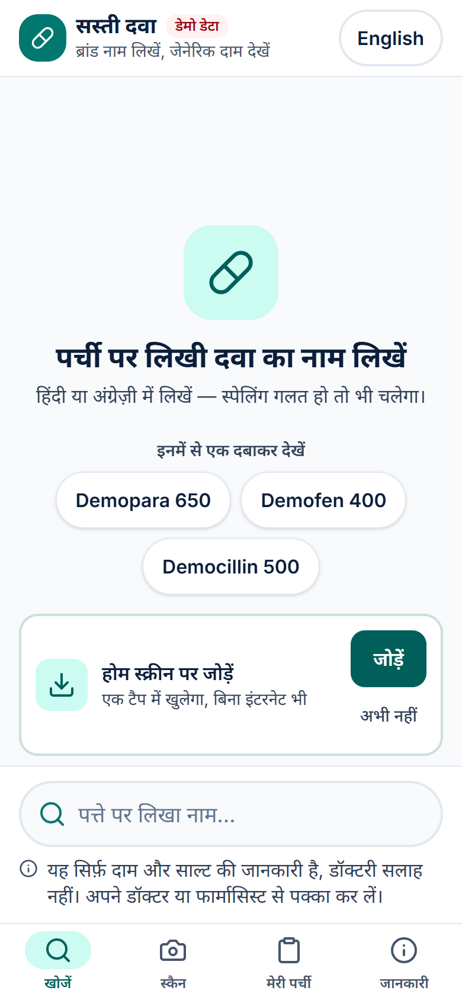
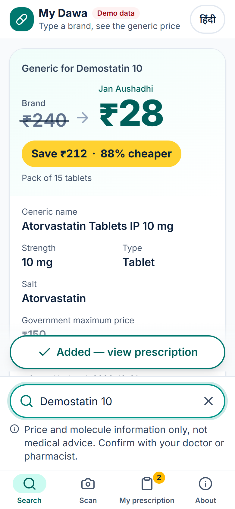

# My Dawa · सस्ती दवा — The Prescription You Cannot Read

> Type or photograph a brand-name medicine. See its generic name, strength and how much you could save, e.g. **₹240 → ₹28**. Hindi-first, works offline.

> ⚠️ **Price and molecule information only, not medical advice. Confirm with your doctor or pharmacist.**

Built at **GDG on Campus SRMCEM Hackfest** (Hacktoberfest) · [MIT licence](LICENSE) · [Security](SECURITY.md) · [Contributing](CONTRIBUTING.md)

> **Demo data notice:** the bundled dataset currently holds **10 SAMPLE rows with fictional brands (all named "Demo…") and placeholder prices**. The app says so on screen ("डेमो डेटा"), in the About screen and on every printout. The real dataset plugs in through `scripts/clean.js` without code changes.

<p>
  
  
  
  
</p>

## The problem

A patient in India leaves the clinic with a prescription for a brand they cannot pronounce, and buys it at whatever price the counter quotes. The same molecule at the same strength is often sold as a generic, for example at a **Pradhan Mantri Bhartiya Janaushadhi Kendra**, for a fraction of the price. Nothing on the strip tells you that.

The people who overpay most are the least able to check: cheap Android phones, patchy signal, more comfortable in Hindi than English, and often older eyes. So the app is built for exactly that: Hindi first, one hand, big targets, and it **works with no internet at all**.

## Features

- **Type any way you like.** Hindi or English, typos, missing spaces, half-read words: `demostatn 10`, `Dolo650`, `डेमोस्टैटिन`. Fuzzy and phonetic matching, ranked by strength.
- **The saving is the headline.** `₹240 → ₹28 · 88% cheaper` per pack, then generic name, strength, form, salt, and the government ceiling price where one exists.
- **Photo scan.** Point the camera at a printed strip or box; Gemma 4 reads the name; **you see and can edit what it read** before searching.
- **"Not found in our data."** If a name is not in the dataset we say so. We never guess.
- **My prescription.** Add several medicines, change pack counts, see the total saving; saved on the phone (IndexedDB), works offline, with undo.
- **Print / PDF for the counter.** A bilingual sheet with brand, generic, strength, prices, sources and the disclaimer.
- **Nearest Jan Aushadhi Kendra.** One tap to Maps or the official website.
- **Offline-first PWA.** Installable; after the first visit typed search makes **zero network requests**.
- **Built for cheap phones.** About 94 KB of JavaScript (gzipped), 48px+ tap targets, works sideways and with large system text, respects reduced motion. Lighthouse mobile: Performance 91–93, Accessibility 100, Best Practices 100, SEO 100.

<details>
<summary>More screenshots</summary>
<p>
  
  
</p>
</details>

## How the AI is used: safe by design

### Which model, and where it runs

| | Hosted (default for the demo) | Local (private, no cloud) |
|---|---|---|
| **Model** | Gemma 4 · `gemma-4-26b-a4b-it` | Gemma 4 · `gemma4:e2b` (smallest vision model; fits ~8 GB RAM) |
| **Runs on** | Google's Gemini API | Your own machine via [Ollama](https://ollama.com) |
| **Speed (measured)** | ~2–3 s per photo | slower on CPU; first scan also loads the model |
| **Switch** | `GEMMA_PROVIDER=hosted` in `.env` | `GEMMA_PROVIDER=ollama` |

The phone never talks to Gemma directly. It sends one shrunken photo to **our small proxy** (`server/`), which holds the key, checks the upload, calls Gemma and returns two short strings.

### Exactly what Gemma is asked

This exact instruction, nothing else:

```text
Read only the printed medicine name and strength visible in the image.
Reply as JSON {name, strength}. If unreadable reply {name: null}.
```

### What Gemma is never allowed to do

- **Never** state a generic name, strength, price, salt or substitute. It never even sees our dataset.
- **Never** decide anything. Its reply is untrusted text: the proxy keeps only `name`/`strength` strings (control characters stripped, length capped, must contain a real word), the phone checks again, and the text lands **only in an editable search box**.
- **Every fact on screen comes from `src/data/drugs.json`.** The text Gemma read must match the dataset through normal search, or the app says "Not found in our data".
- **Never** sees a stored photo: images live in memory for one request, are never written to disk or logged, and the phone strips location (EXIF) before upload.

A real example from testing: on a strip printed "DEMOSTATIN 10 / Atorvastatin Tablets IP 10 mg", Gemma returned the **salt** name `Atorvastatin 10 mg`. The app still showed the right card, because search matched the salt to the dataset entry and the price came from the data, not the model.

## Honest limitations

- **Handwriting is not supported.** Despite the name, the app reads the *printed* name on a strip or box, not a doctor's handwritten prescription. Handwritten text will usually come back "unreadable".
- **Blurry, angled or shiny photos fail.** Glare on foil strips, motion blur and small text all reduce accuracy. Every failure falls back to "type the name instead".
- **Scan accuracy is not yet measured on real photos.** We tested on rendered strips (2 read correctly, 1 blank image correctly "unreadable") and in unit tests; a real-photo test set is future work.
- **The dataset is tiny and fictional today** (10 SAMPLE rows). Most real brands will show "Not found in our data" until the real data is loaded.
- **Prices are indicative.** Brand MRPs vary by pack and change over time; we compare per pack of the same size and show the source and date on every result.
- **Combination drugs and unusual forms** (syrups, injections, different pack sizes) need careful data; the cleaner scales generic prices to the brand pack size when the CSV gives both.
- **Scan needs internet** (to reach the proxy). Typed search does not.
- **Hosted free tier privacy:** with `GEMMA_PROVIDER=hosted`, Google receives the photo and may use free-tier inputs to improve its products. Use local Ollama or a paid tier for real prescriptions.

## Data sources

| Data | Status | Source |
|---|---|---|
| Drug names, strengths, prices | **SAMPLE only** (fictional brands, placeholder prices) | `src/data/drugs.json`, generated for development |
| Jan Aushadhi generic prices | Planned | PMBJP product list, [janaushadhi.gov.in](https://janaushadhi.gov.in/) |
| Government ceiling prices | Planned | NPPA price notifications |
| Search test fixture | Real brand → salt names, **no prices**, tests only, not shipped | `tests/fixtures/search-fixture.json` |

Every row carries `source` and `lastUpdated`, shown on the result card, the About screen and the printout. `npm run data:validate` rejects missing fields, non-numeric prices, duplicates and any row where the generic is not cheaper.

## Credits

**Model:** [Gemma 4](https://ai.google.dev/gemma) by Google DeepMind, under the [Gemma Terms of Use](https://ai.google.dev/gemma/terms); hosted via the Gemini API or run locally with [Ollama](https://ollama.com) (MIT).

| Library | Used for | Licence |
|---|---|---|
| [React](https://react.dev) | UI | MIT |
| [Vite](https://vite.dev) + [@vitejs/plugin-react](https://github.com/vitejs/vite-plugin-react) | Build | MIT |
| [Tailwind CSS](https://tailwindcss.com) + `@tailwindcss/vite` | Styling, design tokens | MIT |
| [vite-plugin-pwa](https://vite-pwa-org.netlify.app) + [Workbox](https://developer.chrome.com/docs/workbox) (`workbox-window`) | Offline service worker | MIT |
| [Fuse.js](https://www.fusejs.io) | Fuzzy search | Apache-2.0 |
| [Express](https://expressjs.com) + [express-rate-limit](https://github.com/express-rate-limit/express-rate-limit) | OCR proxy | MIT |
| [Inter](https://rsms.me/inter/) and [Noto Sans Devanagari](https://fonts.google.com/noto/specimen/Noto+Sans+Devanagari) via [@fontsource-variable](https://fontsource.org) | Self-hosted fonts | SIL OFL 1.1 |
| [Lucide](https://lucide.dev) icon paths (inlined, no package) | Icons | ISC |

No UI component or animation library: the tab bar, bottom sheet, toast, skeleton and animated number are small components in `src/components/ui/`, animated with CSS (transform/opacity, under 300 ms). Design guidance from the `ui-ux-pro-max` skill.

## Run it

Requires **Node.js 20+**.

```bash
git clone https://github.com/yaswantpandey/gdg_hackthon.git
cd gdg_hackthon
npm install
npm run dev                  # app on http://localhost:5173 (typed search works now)
```

**Photo scan** (optional) needs the proxy in a second terminal:

```bash
cp .env.example .env         # PowerShell: Copy-Item .env.example .env
# Hosted: set GEMMA_PROVIDER=hosted, GEMMA_MODEL=gemma-4-26b-a4b-it, GEMMA_API_KEY=<key from aistudio.google.com/apikey>
# Local:  ollama pull gemma4:e2b   (keep GEMMA_PROVIDER=ollama)
npm run server               # proxy on http://127.0.0.1:8787
```

**Offline test:** `npm run build && npm run preview`, open the app once, then turn on aeroplane mode (or DevTools → Network → Offline) and reload.

| Command | What it does |
|---|---|
| `npm test` | 45 tests: search, prices, prescription totals, i18n parity, OCR parser and proxy, security guards |
| `npm run data:validate` | Check `src/data/drugs.json` |
| `npm run data:clean -- raw.csv --source "…"` | Turn a raw CSV into the dataset (refuses to write if validation fails) |
| `npm run i18n:review` | Print every Hindi string next to its English source |

Shareable demo link: `/?q=Demostatin%2010` opens straight to a result.

## Contributing

Contributions of every size are welcome, including Hacktoberfest PRs. See **[CONTRIBUTING.md](CONTRIBUTING.md)** for setup and good first issues: add a language (copy `src/i18n/en.json`), add drugs from a cited public source, add Hindi spellings for better matching, a bundled Jan Aushadhi Kendra list, a real-photo test set for scan accuracy.

Ground rules: never add drug facts generated by an AI, never add substitution advice, never log or store user images.

## Licence

[MIT](LICENSE). Fonts under SIL OFL 1.1; Gemma under the Gemma Terms of Use.
